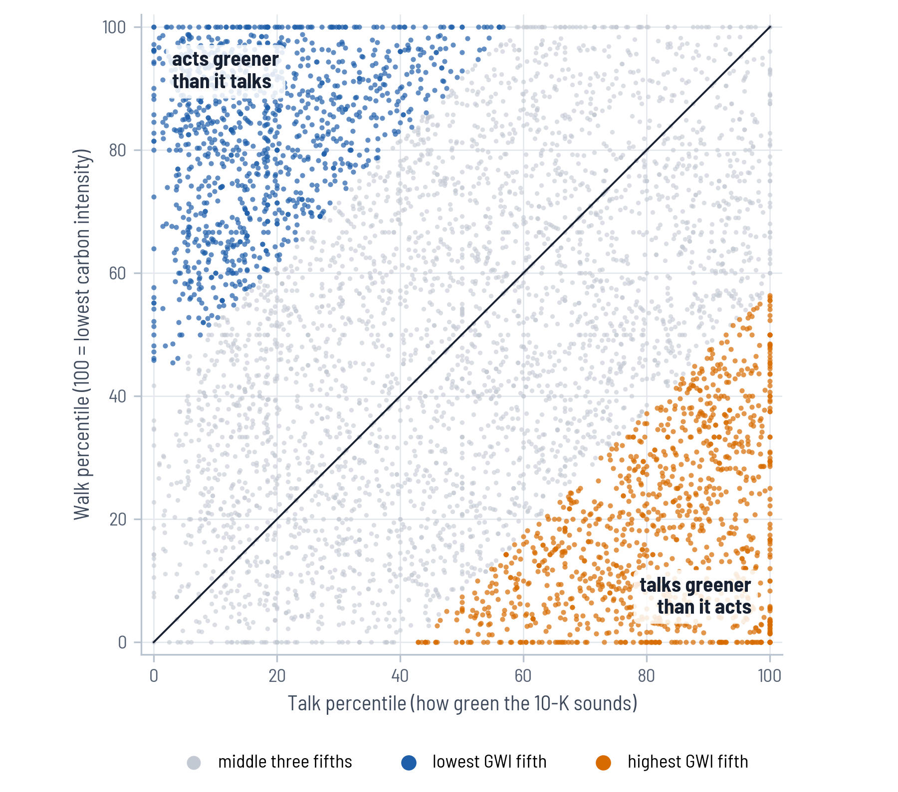

# Greenwashing, ESG Ratings and Stock Returns

Group project for *BMF5324 AI and Statistics for Financial Decision-Making* at the National University of Singapore (Oct 2026).
Team: Arya Garg, Peter Lesmana, Huiyi Zhang, Yannik Schiffner.

**My part:** the *Talk* side. That is the NLP pipeline in [`talk_score/`](talk_score/), which downloads ~7,500 S&P 500 10-K filings from SEC EDGAR, parses them and scores how positively each firm talks about the environment with FinBERT. I also contributed to the analysis notebook.

## The question

A firm can sound greener than it is. We measure the gap as a **Greenwashing Index (GWI) = Talk − Walk**:

- **Talk:** share of positive environmental sentences in the 10-K (Items 1, 1A, 7), scored with FinBERT-ESG and FinBERT-tone, with a Loughran-McDonald dictionary measure as a robustness check.
- **Walk:** how clean the firm's emissions intensity actually is.

Both are ranked against sector peers in the same year. If investors eventually see through the gap, high-GWI firms should earn lower returns (H1), especially after the 2015 Paris Agreement (H2).

## Findings

1. **No reliable return penalty.** The top GWI quintile earns 0.9 pp a year less than the bottom quintile, but p = 0.35, and the gap *shrinks* after Paris instead of growing. The data rule out a penalty larger than about 2.8 pp a year.
2. **The ESG rating is the problem.** LSEG's Environmental Pillar score rewards disclosure and green talk, not lower emissions, so a screen built on it misses most of the firms our index flags. This is the strongest result and the basis of the memo's recommendation.



## Repository layout

| Path | Contents |
|---|---|
| `talk_score/` | Python package for the Talk score: S&P 500 universe and CIK matching, EDGAR download, 10-K section parsing, FinBERT and Loughran-McDonald scoring, industry-year percentiles. 65 unit tests (`pytest`). A Colab notebook runs it on a GPU. |
| `analysis/Talk_vs_Walk_analysis.ipynb` | The full analysis (sector and year fixed effects, clustered standard errors, event study, permutation test with a fixed seed, Holm correction) with the outputs of a complete run. Section 11 checks every number in the memo against the computed value. |
| `data/talk_scores.csv` | Talk score per firm-year (S&P 500, fiscal years 2010–2024) |
| `data/data_dictionary.csv`, `data/PULL_DATES.csv` | Column definitions and data sources with pull dates |
| `figures/` | Figures 1–6 of the memo |

## Data note

The Walk side, ESG ratings and returns come from LSEG (Refinitiv) under a university licence and **are not included** here. The notebook therefore shows the outputs of our run but cannot be re-run without that data. The Talk scores are built only from public SEC filings and are included.

## Running the Talk pipeline

```bash
cd talk_score
pip install -r requirements.txt
pytest
```

See [`talk_score/README.md`](talk_score/README.md) for the full method, conventions and the command-line interface.

## Stack

Python · Hugging Face Transformers (FinBERT) · pandas · statsmodels · BeautifulSoup · SEC EDGAR API · pytest
